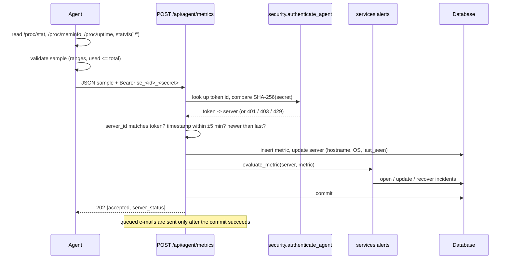
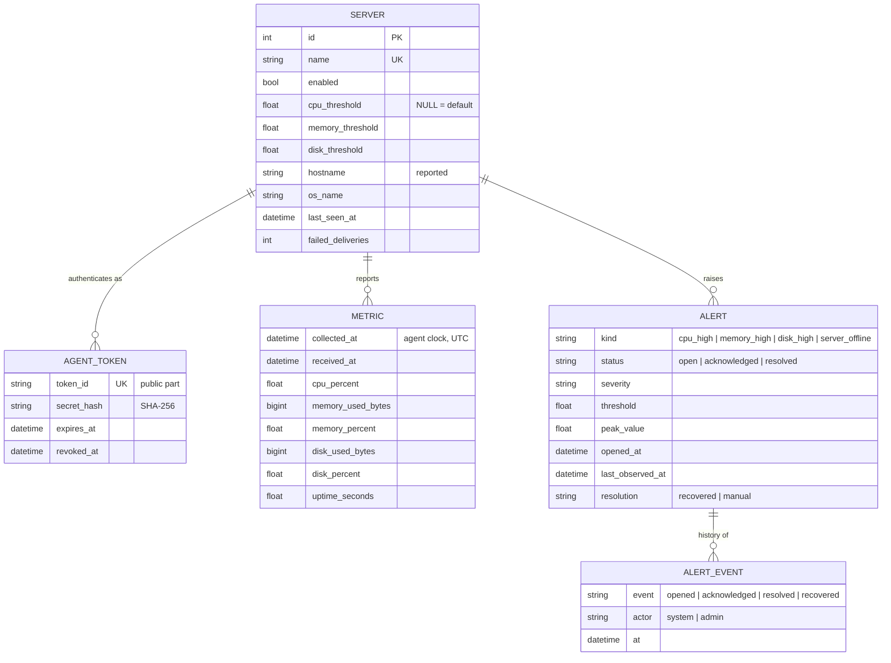
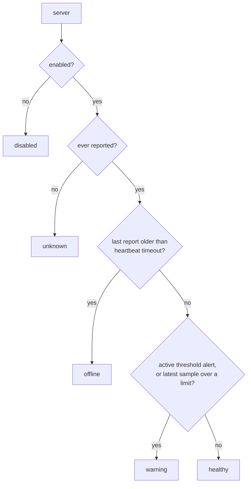
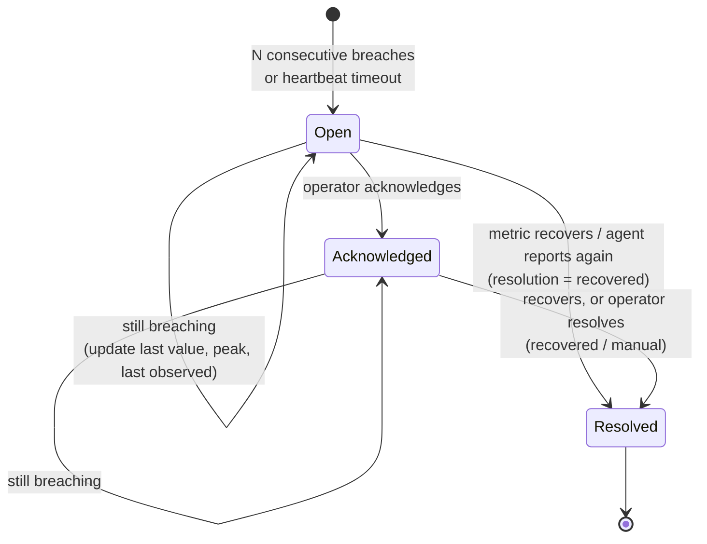

# Architecture

SentinelEye is a modular monolith: one FastAPI process owns the API, the dashboard files, the
alert engine and a small background job, with a relational database behind it. Agents are
separate, deliberately small processes on the monitored servers. Nothing here needs a message
queue, cache or second service, which keeps it easy to run and reason about at the scale it
targets (tens of servers, not thousands).

## Components

| Component | Where | Responsibility |
|---|---|---|
| `sentinel.sh` | central host | Original local health check. Text or JSON, exit code 1 on warning. |
| `main.py` | central host | FastAPI app. Keeps the original `GET /api/health`, mounts the platform. |
| `sentineleye/api/` | central host | HTTP routes: servers and tokens, agent ingestion, overview, alerts. |
| `sentineleye/services/` | central host | Status derivation, alert engine, history queries, background jobs. |
| `sentineleye/security.py` | central host | Token generation and hashing, admin and agent authentication, rate limits. |
| `sentineleye/models.py` | central host | SQLAlchemy tables. |
| `frontend/` | central host | React dashboard, built to static files and served by FastAPI. |
| `agent/` | each Linux server | Collector, HTTP client, retry loop, installer, systemd unit. |

## Request paths

### Agent report

If delivery fails with a network error, a 5xx or a 429, the agent retries with exponential
backoff (capped at half the interval). Authentication and validation errors are not retried.
When a report finally gets through, it carries the number of failed attempts and the last error,
which the backend records on the server.

### Dashboard

The dashboard is a static bundle. In development Vite proxies `/api` to the backend; in Docker
FastAPI serves the bundle itself, so the browser talks to a single origin and no CORS is needed.
Fleet pages send the admin token as a Bearer header and poll every 15 seconds. The dashboard
first asks `GET /api/meta` whether public read-only mode is on; if it is, visitors see the data
straight away and management controls appear only after *Admin sign in*.

## Data model

Notes:

- All timestamps are stored as UTC. A small column type normalises them so SQLite (which has no
  time zones) and PostgreSQL behave the same, and the API always returns ISO 8601 with `Z`.
- Byte counts use `BIGINT`; disk sizes overflow a 32-bit integer.
- `(server_id, collected_at)` is indexed for history queries.
- A partial unique index allows at most one non-resolved alert per `(server_id, kind)`. The alert
  engine already avoids duplicates; the index makes it impossible even under concurrent requests.

## Server status

Status is computed whenever it is read, from `last_seen_at`, the latest metric and the active
alerts. It is never stored, so it cannot go stale.

A server that has never reported is `unknown`, not `offline`. Offline means "used to report and
stopped". The latest sample counts towards `warning` even before an alert opens, so the dashboard
shows a breach immediately while the alert waits out its grace period.

## Alert lifecycle

- **Threshold alerts** (`cpu_high`, `memory_high`, `disk_high`) open when the last
  `SENTINELEYE_ALERT_CONSECUTIVE_BREACHES` samples (default 2) are all at or above the limit. The
  comparison is `>=`, matching `sentinel.sh`.
- **Offline alerts** (`server_offline`) are opened by the background job, which runs every 15 s,
  for enabled servers silent for longer than `SENTINELEYE_HEARTBEAT_TIMEOUT_SECONDS` (default 90,
  three missed 30-second reports). The next report resolves it as recovered.
- A manual resolve closes the incident even if the condition persists; if it is still breaching,
  a new incident opens once the grace period passes again.

## Configuration

All settings live in `sentineleye/config.py` and are read from `SENTINELEYE_*` environment
variables or `.env`. See [.env.example](.env.example). The agent has its own small configuration
(`SENTINELEYE_URL`, `SENTINELEYE_SERVER_ID`, `SENTINELEYE_TOKEN`, `SENTINELEYE_INTERVAL`, …),
documented in [docs/AGENT.md](docs/AGENT.md).

## Decisions and trade-offs

**A Python agent with no dependencies.** Reading `/proc` is simple and stable, so a library such
as psutil was not needed. The agent installs by copying files: there is nothing to `pip install`
on production servers and no dependency to keep patched there.

**CPU over the whole interval.** The agent keeps the previous `/proc/stat` counters between
reports, so each CPU figure is the average over the last 30 s rather than a one-second snapshot.

**Memory "used" is `MemTotal − MemAvailable`.** This is what matters for pressure; counting page
cache as used would make every Linux server look full.

**SHA-256 for agent tokens, not bcrypt.** Tokens are 256-bit random values, not passwords, so a
slow hash adds cost without adding security. A public token id makes lookup a single indexed
query.

**Polling, not WebSockets.** Fifteen-second polling is enough for a monitoring dashboard and keeps
the server stateless.

**SQLite by default.** One file, zero setup, and enough for a single instance with tens of agents
(WAL mode is enabled). The SQLAlchemy layer keeps PostgreSQL a configuration change; it has not
been tested against PostgreSQL yet.

**In-process background job and rate limiter.** Both assume a single backend process. Running
several replicas would need an external scheduler and a shared rate-limit store.
