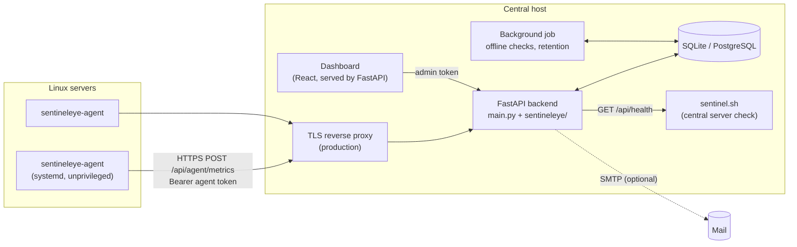

# SentinelEye

**A sharper eye on your infrastructure.**

SentinelEye is a self-hosted monitoring platform for Linux servers. A small Python agent on each
server reports CPU, memory, disk and uptime to a central FastAPI backend, which stores the history,
works out each server's health, raises alerts when limits are crossed or a server goes quiet, and
shows it all on a web dashboard.

It started as a single Bash health-check script and grew into a multi-server system. The original
script is still here, still works on its own, and still powers the dashboard's *Central server* page.

> Independent portfolio project by **Ali Khaleel Hassan**. See [LICENSE](LICENSE).

---

## Contents

- [What it does](#what-it-does)
- [How it works](#how-it-works)
- [Quick start (local development)](#quick-start-local-development)
- [Deploy with Docker](#deploy-with-docker)
- [Monitor a Linux server](#monitor-a-linux-server)
- [API](#api)
- [Security model](#security-model)
- [Testing](#testing)
- [Screenshots](#screenshots)
- [Limitations](#limitations)
- [Roadmap](#roadmap)
- [Project layout](#project-layout)

---

## What it does

**Monitoring**
- A Python agent (standard library only, no pip install on the monitored server) reads `/proc` and
  `statvfs` every 30 seconds: CPU %, memory total/used/available, disk total/used/available,
  uptime, hostname, OS release and kernel.
- Installs as a hardened systemd service under its own unprivileged account.
- Retries network failures with capped exponential backoff and reports how many deliveries
  failed once it reconnects.

**Central backend**
- Server registry with per-server CPU, memory and disk limits (defaults 80 / 85 / 80 %).
- One authentication token per agent; only a SHA-256 hash is stored. Tokens can be revoked,
  reissued and set to expire.
- Metric history in SQLite (SQLAlchemy, so PostgreSQL can be swapped in) with 1h / 6h / 24h / 7d
  queries, downsampled for long ranges, and a retention job that removes old rows.
- Server status derived on every read: `healthy`, `warning`, `offline`, `unknown` (never reported)
  or `disabled`.

**Alerting**
- High CPU, high memory, high disk, and *server unavailable* (no report within the heartbeat
  timeout, 90 s by default).
- A threshold alert opens only after **N consecutive** breaching samples (default 2), so one spike
  does not page anyone.
- One active incident per server and condition. While the condition lasts, the incident is
  updated (last value, peak, last observed) instead of duplicated; the database enforces this with a
  partial unique index.
- Incidents move `open → acknowledged → resolved`. When the metric recovers, the incident closes
  itself as *recovered*. Every step is kept as an event.
- Optional e-mail on open and recovery through SMTP. Monitoring works the same without it.

**Dashboard**
- *Fleet*: overall status, server counts, fleet averages, the server list and recent alert
  activity. New servers can be registered here; the token is shown once.
- *Server*: live usage against its limits, stored history with range and metric selectors, agent
  connection details, alerts, limit settings and token management.
- *Alerts*: active and resolved incidents with acknowledge/resolve and a per-incident timeline.
- *Central server*: the machine running SentinelEye, checked by the original `sentinel.sh`.
- Optional **public read-only mode** (`SENTINELEYE_PUBLIC_DASHBOARD=true`): anyone can browse
  servers, history and alerts without a key; every change still needs the admin token.

Everything on the dashboard comes from the API. There is no sample or placeholder data.

## How it works



1. An operator registers a server and receives an agent token (once).
2. The agent sends a sample every 30 s. The backend checks the token, that the token belongs to
   the `server_id` in the payload, the payload's ranges, and that the timestamp is recent and
   newer than the last one.
3. The sample is stored and evaluated against the server's limits, opening, updating or
   recovering incidents.
4. Every 15 s a background job looks for servers that have gone quiet and opens *server
   unavailable* incidents, and once an hour removes metrics past the retention period.

[ARCHITECTURE.md](ARCHITECTURE.md) covers the data model, alert state machine and design decisions.

## Quick start (local development)

Requirements: Python 3.11+, Node.js 20+.

```bash
python3 -m venv .venv
.venv/bin/pip install -r requirements-dev.txt

cp .env.example .env
# set SENTINELEYE_ADMIN_TOKEN in .env, e.g. to the output of:
python3 -c "import secrets; print(secrets.token_urlsafe(32))"

.venv/bin/python -m fastapi dev main.py          # API on http://127.0.0.1:8000
```

In a second terminal:

```bash
npm --prefix frontend install
npm --prefix frontend run dev                    # dashboard on http://localhost:5173
```

Open http://localhost:5173, sign in with the admin token, and register a server. With
`SENTINELEYE_PUBLIC_DASHBOARD=true` in `.env` the dashboard opens without signing in, read-only;
use *Admin sign in* to manage.
API documentation is at http://127.0.0.1:8000/docs.

The original script still runs on its own (macOS and Linux):

```bash
bash sentinel.sh                                 # human-readable report
OUTPUT_FORMAT=json bash sentinel.sh              # JSON; exit code 1 means a check is in warning
DISK_THRESHOLD=70 CPU_THRESHOLD=90 bash sentinel.sh
```

## Deploy with Docker

```bash
cp .env.example .env          # set SENTINELEYE_ADMIN_TOKEN (and SMTP if wanted)
docker compose up -d --build
docker compose ps             # wait for "healthy"
```

The container serves the API and dashboard on `127.0.0.1:8000`, keeps its database in the
`sentineleye-data` volume, runs as a non-root user on a read-only filesystem, restarts unless
stopped, and caps its logs. No secrets are built into the image.

Agents on other machines must reach it over **HTTPS**. Put a reverse proxy such as Caddy or nginx
in front; [docs/DEPLOYMENT.md](docs/DEPLOYMENT.md) has a working Caddy example, backups and
upgrade steps.

## Monitor a Linux server

Tested on Ubuntu 24.04 with systemd. Needs Python 3.10+ (Ubuntu ships 3.12).

1. Register the server in the dashboard (*Fleet → Register server*) or with the API, and copy the
   **server id** and **token**.
2. On the server, from a copy of this repository:

   ```bash
   cd agent
   sudo ./install.sh --url https://monitor.example.com --server-id 3
   # paste the token when asked; it is not echoed and never goes on the command line
   ```

   The installer creates the `sentineleye` system user, installs the agent to
   `/opt/sentineleye-agent`, writes `/etc/sentineleye-agent/agent.env` (mode 640), sends one test
   sample, and enables the `sentineleye-agent` service.
3. The server turns *Healthy* on the Fleet page within one interval.

```bash
systemctl status sentineleye-agent
journalctl -u sentineleye-agent -f
sudo systemctl restart sentineleye-agent
```

Configuration, troubleshooting, token rotation and removal: [docs/AGENT.md](docs/AGENT.md).

## API

Interactive documentation is generated by FastAPI at `/docs` (Swagger) and `/redoc`.

| Area | Endpoints | Auth |
|---|---|---|
| Original check | `GET /api/health` | none |
| Service probe | `GET /healthz`, `GET /api/meta` | none |
| Agent ingestion | `POST /api/agent/metrics` | agent token |
| Servers | `GET /api/servers`, `GET /api/servers/{id}` | viewer |
| Server changes | `POST /api/servers`, `PATCH/DELETE /api/servers/{id}` | admin |
| Tokens | `GET/POST /api/servers/{id}/tokens`, `POST …/tokens/reissue`, `POST …/tokens/{token_id}/revoke` | admin |
| Monitoring | `GET /api/servers/{id}/status`, `…/metrics/latest`, `…/metrics?range=1h\|6h\|24h\|7d`, `GET /api/overview` | viewer |
| Alerts | `GET /api/alerts`, `GET /api/alerts/{id}`, `GET /api/alert-events` | viewer |
| Alert actions | `POST /api/alerts/{id}/acknowledge`, `POST …/resolve` | admin |

*viewer* means the admin token, or nobody at all when `SENTINELEYE_PUBLIC_DASHBOARD=true`.

`GET /api/health` keeps its original fields (`operating_system`, `disk_usage`, `cpu_usage`,
`memory_total_mb`, `status`) and adds per-check fields (`disk_status`, `disk_threshold`,
`cpu_status`, `cpu_threshold`). Examples with `curl` are in [docs/API.md](docs/API.md).

## Security model

What is implemented:

- **Agent tokens** are 256-bit random secrets with a public lookup id (`se_<id>_<secret>`). The
  database stores only the SHA-256 of the secret; the full token is returned once, at issue time.
  Comparisons are constant-time. Revoked, expired and unknown tokens get the same 401.
- **Server binding**: a token is tied to one server; a payload naming another `server_id` is
  refused (403).
- **Freshness**: samples older or newer than 5 minutes from the backend's clock are rejected, and
  a sample not newer than the last accepted one is refused (409). This blocks simple replays.
- **Input limits**: strict schemas (unknown fields rejected, percentages 0–100, used ≤ total),
  and request bodies over 64 KB are refused (413) whether or not `Content-Length` is sent.
- **Rate limits**: 30 reports per minute per agent token; 10 failed authentication attempts per
  minute per client address.
- **Management API** needs `SENTINELEYE_ADMIN_TOKEN`. If it is not set, those endpoints are
  disabled instead of open.
- **Public read-only mode** is off by default. When on, anonymous visitors can read server
  status, metrics, history and alerts, but not tokens, not the agents' raw error messages (they
  can name internal hosts), and they cannot change anything. Hostnames, OS versions and
  metrics of monitored servers do become public, so only enable it for servers you are happy
  to show.
- **Agent host**: runs as a dedicated non-login user under systemd sandboxing
  (`ProtectSystem=strict`, no capabilities, memory and CPU caps). It refuses to send its token over
  plain HTTP to anything other than localhost unless explicitly overridden.
- **No remote execution**: the agent only reads metrics and sends them. The backend has no way to
  run commands on monitored servers.
- Tokens are not logged by the agent or the backend.

What it does **not** do, so these are not claimed:

- It does not terminate TLS itself. HTTPS is required in production and comes from a reverse
  proxy (see [docs/DEPLOYMENT.md](docs/DEPLOYMENT.md)).
- There are no user accounts or roles. One shared admin token controls the management API; the
  dashboard keeps it in the browser tab's session storage.
- Rate limits are kept in memory, so they apply per backend process.
- Replay protection relies on timestamps and ordering, not signed requests or nonces.

## Testing

```bash
.venv/bin/python -m pytest
```

92 automated tests: 48 for the backend, 42 for the agent, and 2 end-to-end tests where the real
agent code (configuration, `/proc` parsing, HTTP client) reports to the real backend and drives
registration, persistence, a CPU alert, its recovery, offline detection and recovery from it.

Those tests use **controlled values** written as `/proc` files. Separately, the system was run for
real on Ubuntu 24.04.5 LTS hosts in Docker: the installer, systemd service, live metrics, a real
CPU-load alert and its recovery, offline detection after stopping the agent, acknowledgement from
the dashboard, token revocation and reissue, and the Docker deployment.
[docs/TESTING.md](docs/TESTING.md) lists what was checked and how to repeat it.

## Screenshots

Captured from a live run with two Ubuntu 24.04 agents, after a real CPU-load test and an agent
outage.

**Fleet overview**


**Server detail: live usage, stored history (the CPU spike is the load test), agent connection,
alerts and settings**


**Alert centre with incident history**


**Central server: the original `sentinel.sh` check**


<details>
<summary>Phone layout</summary>


</details>

## Limitations

- Remote agents support **Linux only** and were tested on Ubuntu 24.04. Other systemd-based
  distributions should work but have not been tested.
- The local `sentinel.sh` check supports macOS and Linux, as before. On Linux it does not fill
  `memory_total_mb` (it prints `free -h` in text mode instead); this is the script's existing
  behaviour and was left unchanged.
- Agents running in containers see the host kernel's CPU and memory figures, because `/proc/stat`
  and `/proc/meminfo` are not namespaced.
- *Server unavailable* means "no report within the timeout". From the backend's side a powered-off
  server, a network outage and a stopped agent look the same; the agent reports failed deliveries
  when it reconnects, which helps tell them apart afterwards.
- One filesystem per agent (`/` by default).
- Schema changes are applied with `create_all`; there are no migrations yet.

## Roadmap

- Alembic migrations, then PostgreSQL as a documented production option.
- Per-user accounts with roles instead of a single admin token.
- Monitoring several mount points and network interfaces per server.
- Webhook notifications (Slack, Teams, PagerDuty) alongside e-mail.
- Signed agent payloads for stronger replay protection.

## Project layout

```
main.py                    FastAPI app: original /api/health plus the platform routers
sentinel.sh                Original Bash health check (macOS + Linux)
sentineleye/               Central backend
  api/                     Routes: servers, agent ingestion, overview, alerts
  services/                Status, alert engine, history, background jobs
  models.py  schemas.py    Database tables and API contracts
  security.py              Tokens, admin auth, rate limiting
  config.py  db.py         Settings and database setup
agent/                     Linux agent, installer, systemd unit, tests
frontend/                  React dashboard (Vite)
tests/                     Backend and end-to-end tests
docs/                      Agent, deployment, API and testing guides
Dockerfile  compose.yaml   Central deployment
```

## Author

Created by **Ali Khaleel Hassan** as an independent portfolio project. All rights reserved; see
[LICENSE](LICENSE).
