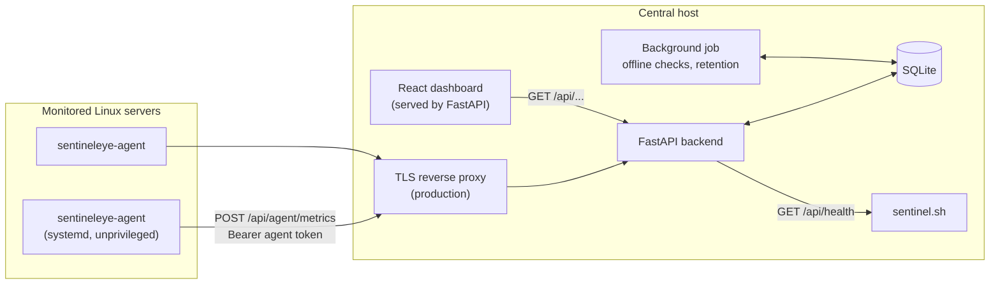
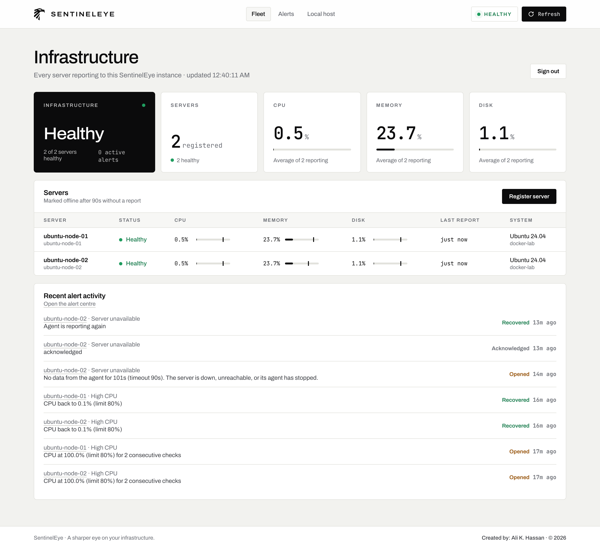
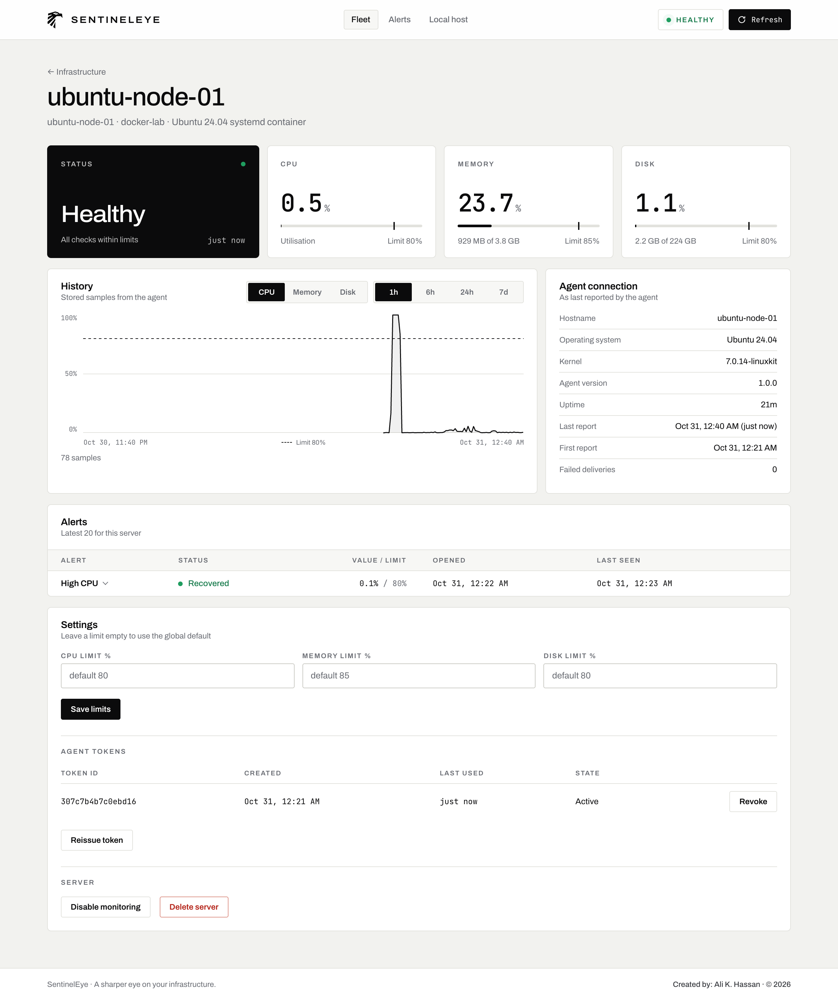
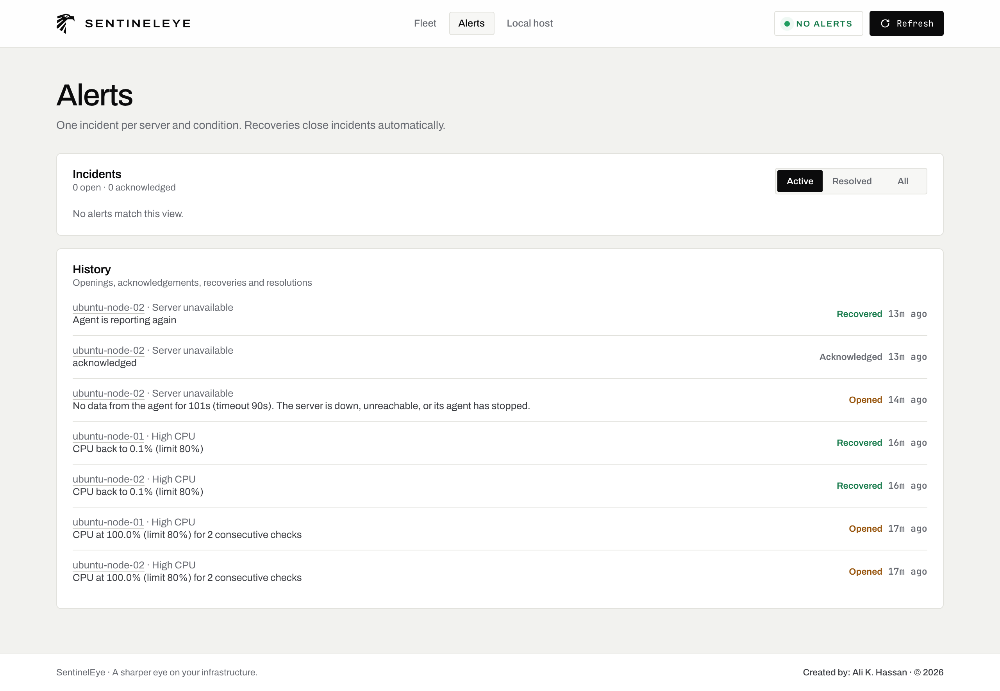
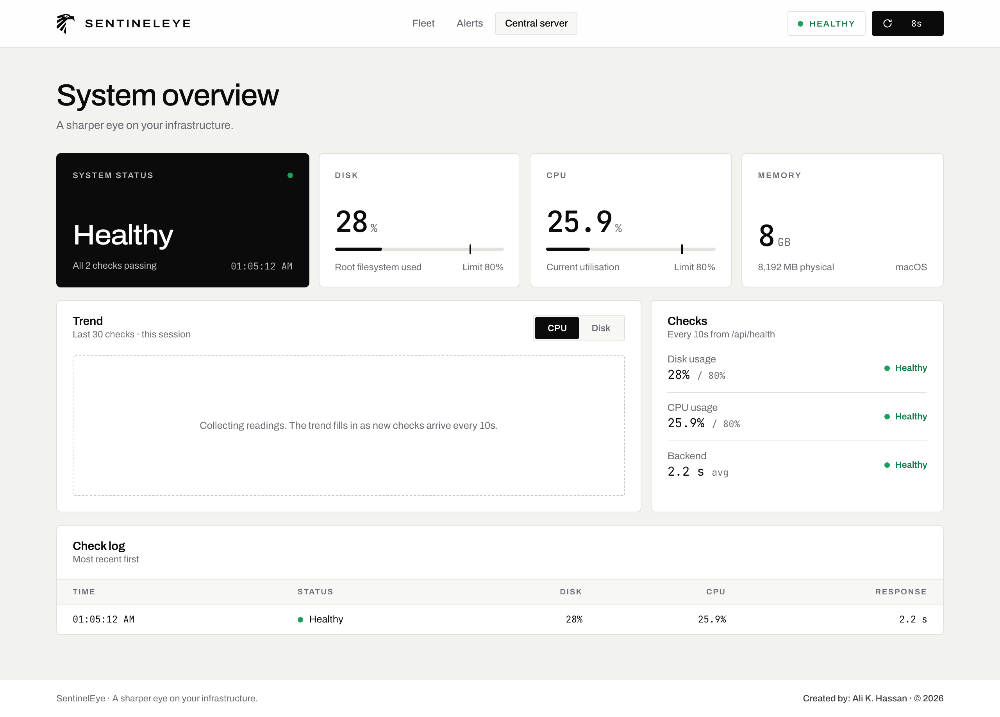
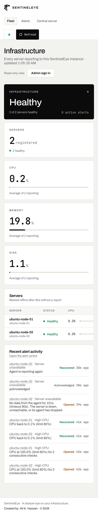

# SentinelEye

**A sharper eye on your infrastructure.**

SentinelEye is a self-hosted monitoring platform for Linux servers. A small agent on each server
reports CPU, memory, disk and uptime to a central FastAPI backend. The backend stores the history,
decides whether each server is healthy, opens and closes incidents when limits are crossed or a
server stops reporting, and shows everything on a web dashboard.

> Independent portfolio project by **Ali Khaleel Hassan**. All rights reserved; see [LICENSE](LICENSE).

| | |
|---|---|
| **What it monitors** | Linux servers (tested on Ubuntu 24.04): CPU, memory, disk, uptime, availability |
| **How** | Python agent → HTTPS → FastAPI backend → SQLite → React dashboard |
| **Alerting** | Threshold and availability incidents with grace period, deduplication and automatic recovery |
| **Tested** | 92 automated tests, plus live runs on Ubuntu 24.04 with real load and real agent outages |
| **Live demo** | [sentineleye-nine.vercel.app](https://sentineleye-nine.vercel.app): read-only, real data from Ubuntu agents. The backend runs on the author's own machine behind a Cloudflare tunnel, so it is not online all the time; when it is down the dashboard says so instead of showing data. |

---

## Documentation

| Document | Contents |
|---|---|
| [Architecture](docs/ARCHITECTURE.md) | Components, data flow, database, health evaluation, alert lifecycle, design decisions |
| [Security](docs/SECURITY.md) | Authentication, tokens, replay protection, limits, access levels, what is and is not implemented |
| [Deployment](docs/DEPLOYMENT.md) | Local development, Docker, configuration, agent installation, HTTPS, troubleshooting |
| [Testing](docs/TESTING.md) | Test suite layout, how to run it, live verification on Ubuntu, Docker validation |
| [Operations](docs/OPERATIONS.md) | Runbook: registering servers, investigating alerts, handling outages, rotating tokens |
| [Interview guide](docs/INTERVIEW_GUIDE.md) | How the system works, explained through likely interview questions |

Reference material also in the repository: [agent guide](docs/AGENT.md) and [API reference](docs/API.md).

## How the project evolved

1. **A Bash health check.** It started as `health-check.sh`, a script that inspects one machine:
   OS, CPU, memory, disk, uptime and top processes, with configurable CPU and disk thresholds,
   readable text output and JSON output. It runs on macOS and Linux and was tested on macOS and on
   Ubuntu 24.04 in Docker. It is now `sentinel.sh`.
2. **An API around it.** A FastAPI backend runs the script and serves its JSON at
   `GET /api/health`. The script deliberately exits with code 1 when a check is in warning while
   still printing valid JSON, so the backend treats exit codes 0 and 1 as results and anything
   else as a failure.
3. **A dashboard.** A React dashboard was added on top of the API, first in a dark theme and then
   redesigned in its current light, minimal style inspired by Anduril and Palantir.
4. **A multi-server platform.** Monitoring one machine through a script does not scale to a
   fleet, so the project grew a Linux agent, a database with history, an alert engine, server
   and token management, and Docker deployment. The original script and endpoint still work and
   are shown on the dashboard's *Central server* page.

## The problem

Anyone running more than a couple of Linux servers needs to know, without logging in to each
one, whether they are up, whether a disk is filling or a CPU is pinned, and when that started.
They also need to be told once when something goes wrong, not every 30 seconds, and to see when
it recovered. SentinelEye covers that core loop: collect, store, evaluate, alert, display.

## How it works



1. An operator registers a server and receives a one-time agent token.
2. The agent on that server reads `/proc` and the root filesystem every 30 seconds and sends a
   JSON sample over HTTPS.
3. The backend authenticates the token, checks that it belongs to the server named in the
   sample, rejects stale or replayed samples, validates the values and stores them.
4. Each sample is compared with the server's limits. Two consecutive breaches open an incident;
   a sample back under the limit closes it as recovered.
5. Every 15 seconds a background job marks servers that have been silent for 90 seconds as
   offline and opens a *server unavailable* incident. Once an hour it deletes metrics older than
   the retention period.
6. The dashboard polls the API and shows the fleet, each server's history and the incidents.

Details: [docs/ARCHITECTURE.md](docs/ARCHITECTURE.md).

## Features

**Standalone check (`sentinel.sh`)**
- OS, uptime, disk usage, CPU usage, memory and the top processes by CPU.
- `DISK_THRESHOLD` and `CPU_THRESHOLD` (default 80), validated as whole numbers up to 100.
- Text output, or JSON with `OUTPUT_FORMAT=json`. Exit code 0 when healthy, 1 on a warning.
- macOS and Linux. On Linux the JSON field `memory_total_mb` is `null` (the text output shows
  `free -h` instead), and the top-process list appears only in text output.

**Linux agent (`agent/`)**
- Python standard library only: `/proc/stat`, `/proc/meminfo`, `/proc/uptime`, `/etc/os-release`
  and `statvfs`. Nothing to `pip install` on monitored servers.
- Reports hostname, OS, kernel, uptime, CPU %, memory and disk (total, used, available, percent).
- Retries network errors, HTTP 5xx and 429 with capped exponential backoff, and reports how many
  deliveries failed once it gets through.
- Installer script and systemd unit; runs as the unprivileged `sentineleye` user with systemd
  sandboxing.

**Central backend (`sentineleye/`, `main.py`)**
- Server registration, update, disable and delete.
- Default limits CPU 80 %, memory 85 %, disk 80 %, overridable per server.
- Metric history with 1h, 6h, 24h and 7d views; long ranges are averaged into at most 360 points.
- Hourly deletion of metrics older than 30 days (configurable).
- Server states: healthy, warning, offline, unknown (never reported) and disabled.
- Interactive API documentation at `/docs`.

**Alerting**
- `cpu_high`, `memory_high`, `disk_high` and `server_offline` incidents.
- Two consecutive breaching samples before a threshold incident opens (configurable).
- One active incident per server and kind, enforced in the database; repeated breaches update it.
- Acknowledge and resolve; automatic resolution as *recovered*; a timeline of every event.
- Optional e-mail on opening and recovery through SMTP.

**Security**
- One token per agent; only a SHA-256 hash of its secret is stored.
- Revocation, reissue and optional expiry (`SENTINELEYE_TOKEN_TTL_DAYS`).
- A token can only submit data for its own server.
- Samples more than 5 minutes from the server clock, or not newer than the last one, are rejected.
- Request bodies over 64 KB and more than 30 reports per minute per agent are refused.
- Optional public read-only mode; all changes require the admin token.
- The agent only reports. There is no remote command execution anywhere in the system.

Details and limits: [docs/SECURITY.md](docs/SECURITY.md).

**Dashboard (`frontend/`)**
- *Fleet*: overall status, server counts, fleet averages, server list, recent alert activity.
- *Server*: live usage against limits, stored history, agent details, incidents; for the admin,
  limits, tokens, disable and delete.
- *Alerts*: active and resolved incidents with their timelines; acknowledge and resolve for the
  admin.
- *Central server*: the original `sentinel.sh` check of the machine running SentinelEye.
- Works on desktop and phone widths.

## Technology

| Area | Used |
|---|---|
| Monitoring script | Bash, standard Unix tools (`df`, `top`, `free`, `ps`, `sysctl`) |
| Agent | Python 3.10+, standard library, systemd |
| Backend | Python, FastAPI, Pydantic, SQLAlchemy 2.0, Uvicorn |
| Database | SQLite (WAL mode) by default; PostgreSQL 18 tested |
| Dashboard | React 19, Vite |
| Deployment | Docker (multi-stage build), Docker Compose, Render Blueprint (`render.yaml`) |
| Tests | pytest, FastAPI TestClient |

## Screenshots

Captured from a live run with two Ubuntu 24.04 agents, viewed without signing in (public
read-only mode). The CPU spike in the history chart is a real load test.

**Fleet overview**



**Server detail**



**Alerts and incident history**



**Central server (the original `sentinel.sh` check)**



<details>
<summary>Phone layout</summary>



</details>

## Getting started

Requirements: Python 3.11+, Node.js 20+.

```bash
python3 -m venv .venv
.venv/bin/pip install -r requirements-dev.txt
cp .env.example .env
python3 -c "import secrets; print(secrets.token_urlsafe(32))"   # put this in SENTINELEYE_ADMIN_TOKEN
.venv/bin/python -m uvicorn main:app --reload                    # API on http://127.0.0.1:8000
```

In a second terminal:

```bash
npm --prefix frontend install
npm --prefix frontend run dev                                    # dashboard on http://localhost:5173
```

`http://localhost:5173` is the local development server. It only exists on the machine running
it and is not a public demo address.

**Docker** (API and dashboard on `http://127.0.0.1:8000`):

```bash
cp .env.example .env      # set SENTINELEYE_ADMIN_TOKEN
docker compose up -d --build
```

**Agent** on a Linux server, after registering the server in the dashboard:

```bash
cd agent
sudo ./install.sh --url https://monitor.example.com --server-id 3
```

The standalone script still works on its own:

```bash
bash sentinel.sh
OUTPUT_FORMAT=json bash sentinel.sh
```

Full instructions, including HTTPS and troubleshooting: [docs/DEPLOYMENT.md](docs/DEPLOYMENT.md).

## Tests

```bash
.venv/bin/python -m pytest
```

92 tests: 48 for the backend, 2 end-to-end tests that run the real agent code against the real
backend, and 42 for the agent. The automated tests use controlled values; the live checks on
Ubuntu 24.04 used real metrics. See [docs/TESTING.md](docs/TESTING.md).

## Security considerations

- Production deployments need HTTPS in front of the backend; the application does not terminate
  TLS itself.
- There is a single shared admin token, not user accounts.
- Public read-only mode makes server names, OS versions and usage visible to anyone. Leave it off
  unless that is intended.
- Rate limits are held in memory and apply per backend process.

See [docs/SECURITY.md](docs/SECURITY.md).

## Limitations

- Remote agents support Linux only and have been tested on Ubuntu 24.04 only.
- SQLite and PostgreSQL 18 pass the full test suite; PostgreSQL has not yet run under long-term
  production load.
- No schema migrations; tables are created on start-up.
- One filesystem per agent (`/` by default).
- From the backend's point of view, a powered-off server, a network outage and a stopped agent
  all look the same: no reports.
- Agents running inside containers report the host kernel's CPU and memory figures.
- E-mail notifications have been tested against a simulated SMTP server only.
- The trend chart and check log on the *Central server* page are kept in the browser and reset on
  reload; fleet history is stored in the database.

## Project layout

```
sentinel.sh                Original Bash health check (macOS and Linux)
main.py                    FastAPI application: GET /api/health plus the platform routers
sentineleye/               Central backend: api/, services/, models, schemas, security, config
agent/                     Linux agent, installer, systemd unit, agent tests
frontend/                  React dashboard
tests/                     Backend and end-to-end tests
docs/                      Documentation and screenshots
Dockerfile, compose.yaml   Central deployment
render.yaml                Render Blueprint (free web service and free Postgres)
```

## Author

Created by **Ali Khaleel Hassan** as an independent portfolio project. All rights reserved; see
[LICENSE](LICENSE).
