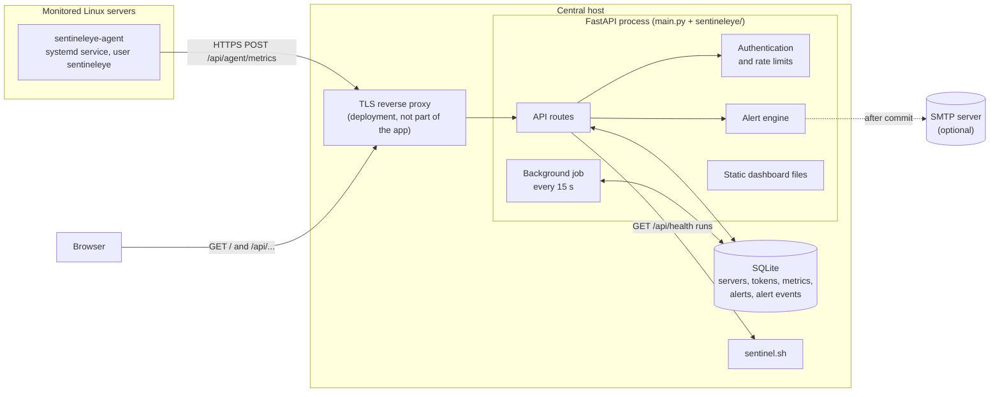
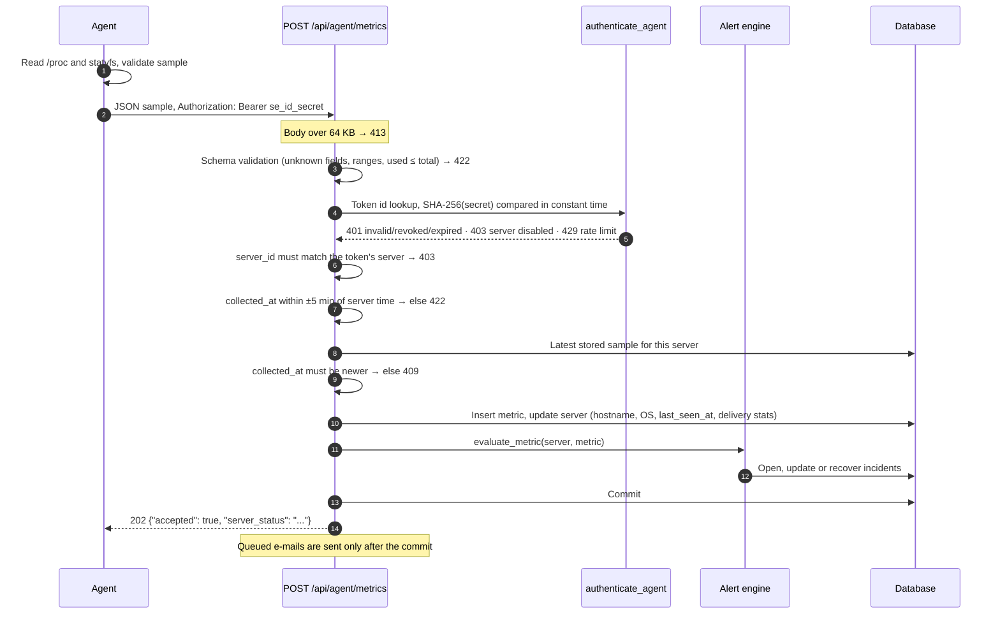
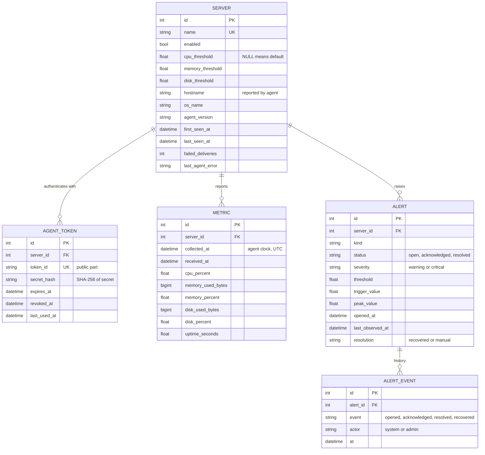
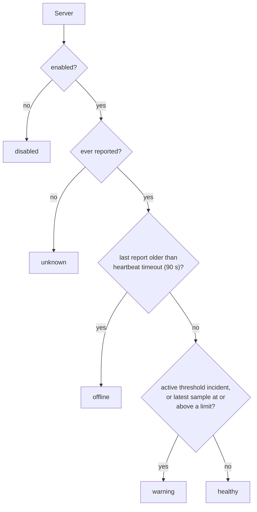
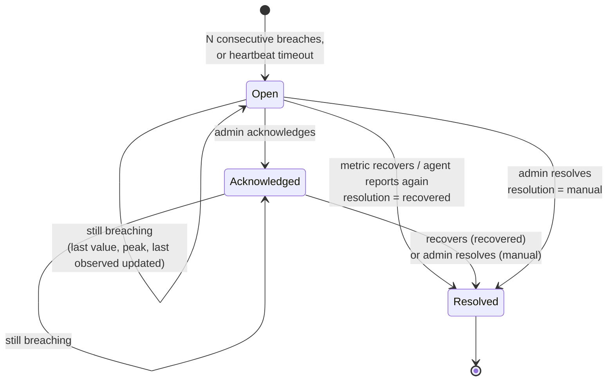

# Architecture

SentinelEye is a modular monolith. One FastAPI process owns the API, the alert engine, a small
background job and the dashboard's static files, with a relational database behind it. Agents
are separate, deliberately small processes on the monitored servers. There is no message queue,
cache or second service, which keeps the system easy to run and to reason about at the scale it
targets: tens of servers.

## High-level view

| Component | Location | Responsibility |
|---|---|---|
| `sentinel.sh` | repository root | Original standalone check; behind `GET /api/health` |
| `main.py` | repository root | Creates the FastAPI app, keeps `GET /api/health`, wires in the platform |
| `sentineleye/api/` | central | Routes: `servers.py`, `agent.py`, `overview.py`, `alerts.py` |
| `sentineleye/services/` | central | `status.py` (health), `alerts.py` (engine), `history.py`, `maintenance.py` (jobs) |
| `sentineleye/security.py` | central | Token generation and hashing, admin and agent authentication, rate limiter |
| `sentineleye/models.py`, `schemas.py` | central | Database tables and API request/response contracts |
| `sentineleye/web.py` | central | Start-up, body-size limit, optional CORS, `/api/meta`, `/healthz`, static files |
| `sentineleye/notify.py` | central | Optional SMTP notifications |
| `frontend/` | built into `frontend/dist` | React dashboard |
| `agent/` | each monitored server | Collector, HTTP client, retry loop, installer, systemd unit |

## The original utility

`sentinel.sh` is the project's starting point and still works on its own.

- **OS and uptime** come from `uname -s` and `uptime`.
- **Disk** is the use percentage of `/` from `df -P /`, compared with `DISK_THRESHOLD`.
- **CPU** on macOS is `100 − idle` from the second sample of `top -l 2`. On Linux it reads the
  aggregate `cpu` line of `/proc/stat` twice, one second apart, and computes
  `(1 − Δidle / Δtotal) × 100`.
- **Memory** on macOS is `hw.memsize` from `sysctl`. On Linux the text output prints `free -h`
  and the JSON field `memory_total_mb` stays `null`.
- **Top processes** are the first lines of `ps aux`, in text output only.
- `OUTPUT_FORMAT=json` sends the human-readable text to `/dev/null` and prints one JSON object
  at the end. The exit code is 0 when every check passes and 1 when any check is in warning or
  could not run, and the JSON is printed in both cases.

`GET /api/health` in `main.py` runs `bash sentinel.sh` with `OUTPUT_FORMAT=json`. Because exit
code 1 means "warning, valid JSON", only codes other than 0 and 1 are treated as a script failure
(HTTP 500 `SentinelEye script failed`); unparseable output returns HTTP 500 `Invalid JSON returned
by SentinelEye`. The call has no timeout.

## The agent

The agent (`agent/sentineleye_agent/`) runs as a systemd service and loops: collect, validate,
send, wait for the rest of the interval (30 s by default).

### Linux metric collection

| Metric | Source | Calculation |
|---|---|---|
| CPU % | `/proc/stat`, aggregate `cpu` line | Fields 1–8 (user … steal) summed as *total*; idle + iowait as *idle*. CPU % = `(1 − Δidle / Δtotal) × 100` between this report and the previous one, so each figure covers the whole interval. The first report samples twice, one second apart. |
| Memory | `/proc/meminfo` | `used = MemTotal − MemAvailable`; percent = `used / MemTotal × 100`. Page cache the kernel can reclaim is not counted as used. |
| Disk | `os.statvfs("/")` | `total = f_blocks × f_frsize`, `available = f_bavail × f_frsize`, `used = (f_blocks − f_bfree) × f_frsize`; percent = `used / (used + available) × 100`, the same formula as `df`. |
| Uptime | `/proc/uptime` | First field |
| OS | `/etc/os-release`, `os.uname()` | `NAME`, `VERSION_ID`, kernel release |
| Hostname | `socket.gethostname()` | Characters outside `A–Z a–z 0–9 . _ -` replaced |

Before sending, `validate_sample` rejects impossible values (percentages outside 0–100, used
greater than total, negative uptime). Any collection error skips that cycle and is logged.

### Delivery

The client (`client.py`) uses `urllib` to `POST` JSON to `SENTINELEYE_URL/api/agent/metrics`
with `Authorization: Bearer <token>`. Errors are classified:

- **Retried** (exponential backoff with jitter, capped at half the interval, up to
  `SENTINELEYE_MAX_RETRIES`, default 4): connection errors, timeouts, HTTP 429, HTTP 5xx,
  responses that are not JSON or do not confirm acceptance.
- **Not retried**: 401, 403 and 422. They mean the configuration or token is wrong, so retrying
  would not help.
- **409** means the backend already has this or a newer sample (typically an earlier attempt got
  through but its response was lost). It is skipped and not counted as a failure.

The agent counts failed attempts since its last successful delivery and includes the count and
the last error in the next sample (`delivery.failed_attempts`, `delivery.last_error`). The
backend stores them on the server record.

### Transport

The agent sends its token only over HTTPS, except to `localhost`, `127.0.0.1`, `::1` and
`host.docker.internal`, unless `SENTINELEYE_ALLOW_HTTP=true` is set. The backend itself speaks
plain HTTP; TLS is terminated by a reverse proxy in front of it. Certificate verification uses
the system CA store, or `SENTINELEYE_CA_BUNDLE` for a private CA.

## Metric ingestion

## Database

SQLite through SQLAlchemy 2.0, file `data/sentineleye.db` locally and `/data/sentineleye.db` in
Docker. Foreign keys and WAL mode are switched on at connection time. Tables are created at
start-up with `create_all`; there are no migrations.

Design points:

- **UTC everywhere.** A custom column type stores naive UTC and returns timezone-aware UTC, so
  SQLite (which has no time zones) and PostgreSQL would behave the same. The API returns ISO 8601
  with `Z`; the dashboard converts to local time.
- **`BIGINT` for byte counts.** Disk sizes overflow a 32-bit integer.
- **`(server_id, collected_at)` index** for history queries and the "latest sample" lookup.
- **Partial unique index** `uq_alerts_active` on `(server_id, kind) WHERE status != 'resolved'`:
  the database itself refuses a second active incident of the same kind for the same server.
- Deleting a server cascades to its tokens, metrics, alerts and alert events.

### History and retention

`GET /api/servers/{id}/metrics?range=1h|6h|24h|7d` returns every sample in the window when there
are 360 or fewer. Above that, samples are grouped into 360 equal time buckets and averaged, and
each point says how many samples it represents. At one sample every 30 seconds, 6h and longer
ranges are bucketed.

The background job deletes metrics older than `SENTINELEYE_METRIC_RETENTION_DAYS` (30 by default)
once an hour. Alerts and their events are kept.

## Health evaluation

Status is computed whenever a server is read, from its record, its latest sample and its active
incidents. It is never stored, so it cannot go stale.

- *Unknown* and *offline* are different: unknown has never reported; offline used to report and
  stopped.
- A single breach shows as *warning* straight away, before the grace period has opened an
  incident.
- Effective limits are the server's own values, or the defaults (CPU 80, memory 85, disk 80).
- The fleet overview counts servers by status and averages CPU, memory and disk over servers that
  are currently healthy or in warning.

## Alert engine

Implemented in `sentineleye/services/alerts.py`.

**Threshold incidents** (`cpu_high`, `memory_high`, `disk_high`, severity *warning*) are evaluated
for every accepted sample:

- At or above the limit (`>=`, the same comparison as `sentinel.sh`):
  - If an incident of that kind is active, update `last_value`, `peak_value` and
    `last_observed_at`.
  - Otherwise, if the last `SENTINELEYE_ALERT_CONSECUTIVE_BREACHES` samples (default 2) are all at
    or above the limit, open one.
- Below the limit with an active incident: resolve it as *recovered*.

**Availability incidents** (`server_offline`, severity *critical*) are opened by the background
job for enabled servers whose last report is older than `SENTINELEYE_HEARTBEAT_TIMEOUT_SECONDS`.
The next accepted sample resolves it as *recovered*.

Every transition writes an `alert_events` row with the actor (`system` or `admin`) and a detail
message. A manually resolved incident whose condition continues is followed by a new incident
once the grace period passes again.

**E-mail.** When `SENTINELEYE_SMTP_HOST`, `SENTINELEYE_SMTP_FROM` and `SENTINELEYE_SMTP_TO` are
set, a message is queued when an incident opens and when it recovers. Messages are sent on a
background thread after the database commit, so a rolled-back change never sends mail, and a
delivery failure is logged without affecting monitoring.

## Background job

`services/maintenance.py` runs inside the FastAPI process every
`SENTINELEYE_BACKGROUND_INTERVAL_SECONDS` (15). Each cycle opens *server unavailable* incidents
for silent servers, and once an hour deletes expired metrics. Failures are logged and retried
next cycle. It can be switched off with `SENTINELEYE_RUN_BACKGROUND_JOBS=false` (the tests do
this).

## Dashboard

A React 19 single-page app built with Vite. In development, Vite serves it on port 5173 and
proxies `/api` to the backend. In Docker, FastAPI serves the built files from the same origin, so
no CORS is needed. Routes are hash-based (`#/`, `#/servers/3`, `#/alerts`, `#/central`,
`#/signin`), which keeps the build a set of static files.

On load it calls `GET /api/meta` to learn whether public read-only mode is on. Fleet pages poll
the API every 15 seconds; management controls are shown only after *Admin sign in*, which keeps
the admin token in the browser tab's `sessionStorage`. The *Central server* page polls
`GET /api/health` every 10 seconds and keeps its trend chart and check log in memory for the
current tab.

## Design decisions

**An agent rather than remote polling.** The central server never needs SSH access or open ports
on monitored machines. Agents push over outbound HTTPS, which works through NAT and firewalls,
and a server that stops pushing is itself a signal.

**A Python agent with no dependencies.** `/proc` is simple and stable, so psutil was not needed.
Installing means copying files; there is nothing to `pip install` or keep patched on production
servers.

**SHA-256 for tokens, not bcrypt.** Agent secrets are 256-bit random values, not human
passwords, so a slow hash adds cost without adding security. The public token id makes lookup a
single indexed query.

**Status computed on read.** Nothing has to remember to update a status column, and a server
cannot stay "healthy" after its agent goes quiet.

**Grace period plus database-enforced deduplication.** The grace period filters single spikes;
the unique index guarantees one incident per condition even under concurrent requests.

**Polling instead of WebSockets.** A 15-second refresh is enough for this kind of dashboard and
keeps the backend stateless.

**SQLite and an in-process job.** One file and one process are enough for tens of agents and
make the project easy to run anywhere. The cost is that the rate limiter and background job
assume a single backend process; see the scaling notes in the
[interview guide](INTERVIEW_GUIDE.md).
